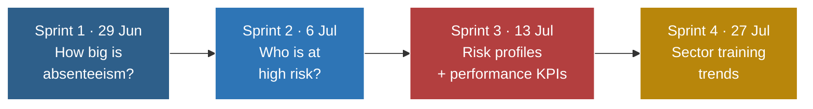

# 📊 HR Risk & Training Analytics
### Statistical analysis for business decisions — from SQL audit to recommendations


**4 weekly sprints · team of 4 analysts · fictional logistics company (RapidExpress, 500+ employees)**

> Personal portfolio copy of a team project developed at IT Academy (Barcelona Activa).
> Team: Vanessa Bujaldon Pellicer · Nizar el Ourama Sorribas · Raúl Martínez Aparicio · Hamza Messaoudi

---

## 👩‍💻 My contribution

- **Training-barriers analysis (Sprint 4, owner):** extraction of semi-structured public Excel tables, 2024 ranking, 2022→2023→2024 evolution with **proportion Z-tests using the official survey sample sizes**, trend classification and benchmark of large companies vs. the services sector — [`Analisis_EAL_Barreras_2026-07-20.ipynb`](Scripts/Analisis_EAL_Barreras_2026-07-20.ipynb)
- **[CONFIRMA: what you did in Sprints 1–3 — e.g. SQL data audit, statistical tests, logistic regression, notebook integration, repository quality role]**

---

## At a glance

| Absenteeism hours analysed | Employees | Absenteeism risk with disciplinary record | #1 barrier to training |
|:---:|:---:|:---:|:---:|
| **5,043 h** | **136** | **× 5.5** | **55% workload / lack of time** |



The project moves from **describing** absenteeism (S1) to **predicting** who is at risk (S2), **preventing** it with costed actions (S3), and finally **widening the focus** to training policy using external sector data (S4).

<!-- Add 1–2 screenshots here, e.g. a Power BI page and a key chart:
 -->

---

## Sprints 1–3 · Absenteeism and performance

**Data:** HR dataset of a fictional logistics company (based on the public UCI *"Absenteeism at Work"* dataset), loaded in MySQL and queried with SQLAlchemy.

**Sprint 1 — How big is absenteeism?**
- **5,043 total hours** · **152.8 h per employee**; three employees account for more than 25% of the total
- Monthly peak in **March** (755 h); most frequent reason: **medical appointments** (142 absences)

**Sprint 2 — Who is at high risk?**
- Binary logistic regression on high absenteeism (136 employees)
- **Key finding:** no relationship with personal attributes — the only real link is with **workload management**

**Sprint 3 — Risk profiles and performance KPIs**
- Ordinal logistic regression (4 levels): a disciplinary record **multiplies by 5.5** the odds of high absenteeism; the "Severe" level concentrates **67% of lost working days**
- Composite performance score (8 KPIs): **workload** is the only robust, negative predictor, consistent across all 8 KPIs (Spearman −0.10 to −0.13)

## Sprint 4 · Sector training trends

**Business question:** how should the company adjust its training policy to match sector trends in key skills, training methods and common barriers?

**Data:** Spanish Annual Labour Survey (EAL), Ministry of Labour and Social Economy, 2022–2024.

| Block | Main finding |
|---|---|
| Skills | Job-specific technical skills (45%), customer service (31.5%) and teamwork (30.1%) lead the 2024 training offer |
| Methods | External courses (79.7%) and on-the-job training (52%) dominate over conferences or job rotation |
| **Barriers** | **Workload / lack of time (55%)** and **"staff already well trained" (53%)** are the only barriers above 50%. Z-tests per period show that **only 6 of 16 year-on-year changes are statistically reliable** |

---

## 🛠️ Tech stack

- **Python:** pandas, numpy, matplotlib, plotly, statsmodels (`proportions_ztest`, logistic / ordinal regression), scikit-learn
- **Database:** MySQL via SQLAlchemy
- **Excel / openpyxl:** extraction of semi-structured public tables
- **Business deliverables:** Power BI dashboards + PowerPoint business reports
- **Version control:** Git / GitHub (team branch workflow)

## 🗂️ Repository structure

```
├── Scripts/    Jupyter notebooks — each sprint follows Data_cleaning → EDA → Analysis
├── Data/       Raw and clean datasets + EAL public survey (raw and processed)
├── Results/    Business reports (.pptx / .pdf) and Power BI dashboards (.pbix)
└── README.md
```

## 🧭 How to navigate

- **Business view →** read the business reports (PDF, in Spanish) in chronological order:
  [Sprint 1](Results/BusinessReport-2026-06-29.pdf) · [Sprint 2](Results/BusinessReport-2026-07-06.pdf) · [Sprint 3](Results/BusinessReport-2026-07-13.pdf) · [Sprint 4](Results/BusinessReport-2026-07-27.pdf)
- **Code view →** the first markdown cell of each notebook summarises that week's business question and method.
